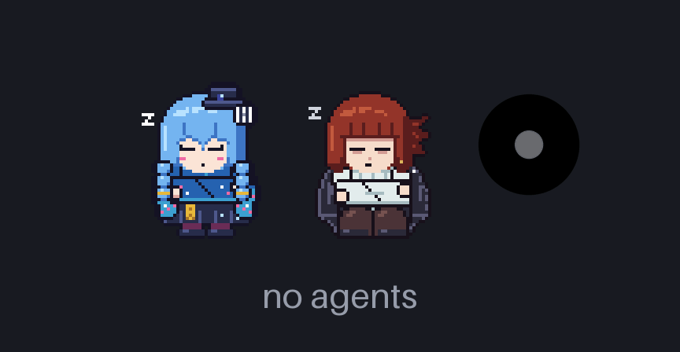

Made assistance to accompany me vibe code



## Agent approvals

Approvals currently work for Claude Code; Codex and OpenCode are coming. When Claude Code asks permission for a tool, the island shows the request: a card with Allow, Deny, Always allow (when the agent offers it) and Open terminal buttons in the Agents tab, plus a badge on the collapsed island. If the island is collapsed and no fullscreen window is up, it also pops open without taking focus. It shows the first pending request ("1 of N") with a countdown bar that empties after 45 s, when the agent falls back to its own prompt. Nothing is ever allowed or denied except by a click, and the island never takes keyboard focus.

Hooks are installed into the agent CLIs from WSL:

```
island-bridge hooks install   # add the island's hooks (backs up each file first, idempotent)
island-bridge hooks remove    # remove exactly those entries
```

`scripts/install.sh` runs `hooks install` for you. Once Codex support lands, Codex will ask you to trust its newly added hook with `/hooks`.
